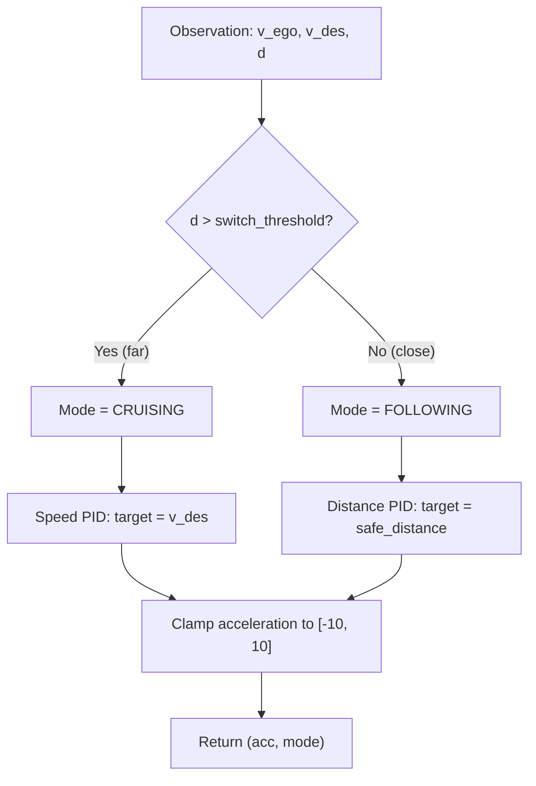

# Plan: Adaptive Cruise Control (ACC) Controller — CSCI 513 Mini-Project 1

## 1. Problem Summary

Design an ACC controller for an ego car in CARLA. The **only deliverable** is [`mp1_controller/controller.py`](file:///Users/jeremydefreitas/Downloads/csci513-miniproject1/mp1_controller/controller.py). The controller receives an [`Observation`](file:///Users/jeremydefreitas/Downloads/csci513-miniproject1/mp1_simulator/simulator.py#L52-L56) (ego velocity, desired speed = 20 m/s, distance to lead) at 10 Hz (200 steps × 0.1 s = 20 s per episode) and must return `(acceleration, Mode)` where acceleration ∈ [−10, 10] and mode ∈ {`CRUISING`, `FOLLOWING`}.

> [!IMPORTANT]
> Distance is **center-to-center** (cars are ~4.5–5 m long), so `d ≥ 4` is the hard safety bound but a collision actually occurs well before that. The controller must use a much larger safe-following margin in practice.

---

## 2. Requirements (STL Specifications)

| # | Name | Plain English | Key Thresholds |
|---|------|---------------|----------------|
| 1 | `safeFollowing` | Always keep `d ≥ 4 m` | `d_safe = 4 m` |
| 2 | `forwardProgress` | Never go backwards (`v ≥ 0`) | — |
| 3 | `dontStopUnlessLeadStops` | After t = 3 s, don't stop (`v < 0.1`) while the lead is moving (`v_lead > 0.1`) | `v_thresh = 0.1 m/s` |
| 4 | `notFollowWhenFarAway` | When `d > 40 m`, switch to `CRUISING` within 2 s (or gap closes) | `d_follow = 40 m`, `t = 2 s` |
| 5 | `reachTargetWhenNotFollowing` | In `CRUISING` mode, reach within 2 m/s of `v_des` within 6 s (or switch to `FOLLOWING`) | `v_close = 2 m/s`, `t = 6 s` |

---

## 3. Scenario Analysis

There are **15 test scenarios** in [`test_data/`](file:///Users/jeremydefreitas/Downloads/csci513-miniproject1/test_data):
- **5 × `scenario1_*`**: Ego starts 100 m behind lead. Lead steers laterally (lane-change) and eventually `d → inf`. In some variants the lead also brakes hard and stops.
- **10 × `scenario3_*`**: Similar starting positions. Lead has complex behavior—accelerate, brake, steer out, stop, restart. Some scenarios feature the lead leaving the lane entirely (d = inf) then returning.

Key behaviors observed from the action data:
- Lead car **always starts stationary** (both are at rest).
- Lead can **abruptly brake** (full brake for 30+ steps), causing rapid closing.
- Lead can **leave the lane** (large steer), making `d = inf`.
- Lead can **stop and restart**, meaning ego must follow suit without itself stopping unnecessarily.

---

## 4. Controller Design

### 4.1 Architecture: Dual-Mode PID with Smooth Switching



### 4.2 Mode Switching Logic

| Condition | Action |
|-----------|--------|
| `d > 40 m` or `d == inf` | `CRUISING` — drive at `v_des` |
| `d ≤ distance_threshold` (use ~25–30 m) | `FOLLOWING` — maintain safe gap |
| In between (hysteresis band) | Keep current mode to avoid oscillation |

> [!TIP]
> Use **hysteresis** to prevent chattering: switch to `CRUISING` when `d > 40`, switch to `FOLLOWING` when `d < 25`. This satisfies `notFollowWhenFarAway` (must be cruising when `d > 40`) while avoiding rapid toggling.

### 4.3 Cruising Mode Controller

A **proportional-integral (PI) speed controller**:

```
error = v_des - v_ego
acc = Kp_cruise * error + Ki_cruise * integral(error)
```

- Tuning target: reach `|v - v_des| < 2 m/s` within 6 seconds from any speed.
- `Kp_cruise ≈ 2.0–4.0`, `Ki_cruise ≈ 0.1–0.5` (to be tuned).
- Clamp integral to prevent windup.

### 4.4 Following Mode Controller

A **PD controller on distance** with a velocity-dependent safe gap:

```
safe_gap = max(d_safe_min, time_gap * v_ego)
    where d_safe_min ≈ 10 m (generous margin above the 4 m hard limit)
    and time_gap ≈ 1.0 s

error_d = d - safe_gap
acc = Kp_follow * error_d + Kd_follow * (error_d - prev_error_d) / dt
```

- Additional clamp: if `d < emergency_brake_dist` (~7 m), apply strong braking (`acc → −10`).
- Never brake so hard that `v` goes negative (clamp `acc ≥ -v/dt` if `v` is small).

### 4.5 Edge Cases

| Situation | Handling |
|-----------|----------|
| `d = inf` (lead left lane) | Treat as cruising, target `v_des` |
| `v_ego ≈ 0` and lead stopped | Stay stopped gently (`acc ≈ 0`), stay in `FOLLOWING` if `d` is small |
| Initial phase (t < 3 s) | Both cars at rest; lead stationary. Ego should start accelerating. The `dontStopUnlessLeadStops` requirement only activates after t = 3 s, so initial slow start is fine. |
| Lead brakes suddenly | Distance PD should react; emergency braking if gap closes fast |

---

## 5. Implementation Plan

### Step 1: Scaffold the Controller
- [x] Add state variables to `__init__`: integral term, previous error, previous mode, time step counter.
- [x] Implement `run_step` skeleton with mode selection and two control branches.

### Step 2: Implement Cruising Mode
- [x] PI controller targeting `v_des = 20 m/s`.
- [x] Anti-windup on integral term.

### Step 3: Implement Following Mode
- [x] PD controller on distance gap.
- [x] Velocity-dependent safe distance.
- [x] Emergency braking for critically small gaps.
- [x] Ensure `v ≥ 0` (no reverse).

### Step 4: Mode Switching with Hysteresis
- [x] Implement threshold logic with hysteresis band.
- [x] Handle `d = inf` gracefully.

### Step 5: Tune & Validate
- [ ] Run all 15 scenarios in CARLA: `python3 -m mp1_simulator test_data/*`
- [ ] Evaluate: `python3 -m mp1_evaluation logs/*`
- [ ] Iterate on gains (`Kp`, `Ki`, `Kd`) and thresholds until all 5 requirements pass on all 15 scenarios.

> [!NOTE]
> Since CARLA requires a GPU and we're on macOS, you'll need to either:
> 1. Use the HPC cluster (see [`HPC-Instructions.md`](file:///Users/jeremydefreitas/Downloads/csci513-miniproject1/HPC-Instructions.md))
> 2. Use a Linux machine with Docker + NVIDIA GPU
> 
> We can write and reason about the controller code locally, but simulation testing requires CARLA running on a GPU-equipped machine.

---

## 6. Suggested Initial Gains

| Parameter | Value | Purpose |
|-----------|-------|---------|
| `Kp_cruise` | 3.0 | Speed proportional gain (cruising) |
| `Ki_cruise` | 0.3 | Speed integral gain (cruising) |
| `Kp_follow` | 1.5 | Distance proportional gain (following) |
| `Kd_follow` | 2.0 | Distance derivative gain (following) |
| `d_safe_min` | 10.0 m | Minimum safe following distance |
| `time_gap` | 1.0 s | Time-based headway |
| `follow_enter` | 25.0 m | Switch TO following below this |
| `follow_exit` | 40.0 m | Switch TO cruising above this |
| `emergency_d` | 7.0 m | Trigger emergency braking |

---

## 7. Constraints & Gotchas

> [!WARNING]
> - **Do NOT modify** any file other than `controller.py` — the autograder uses its own copies.
> - **Do NOT import** packages beyond standard library, `numpy`, and `scipy`.
> - The controller is reinstantiated per scenario (`__init__` is called fresh each time).
> - `distance_threshold` is passed as `4` from [`CONFIG`](file:///Users/jeremydefreitas/Downloads/csci513-miniproject1/mp1_simulator/simulator.py#L40) — this is the hard safety limit, not your target gap.
> - Acceleration is converted internally: positive → throttle (`acc/10`), negative → brake (`-acc/20`). So braking is "gentler" per unit of control input.

> [!CAUTION]
> The acceleration-to-brake conversion is asymmetric: `throttle = acc/10` but `brake = -acc/20`. This means `-10` only gives 50% brake. For emergency stops you're limited. Design the controller to start braking earlier rather than relying on maximum deceleration.

---

## 8. Definition of Done

✅ All 5 STL requirements satisfied on all 15 scenarios (100% score).  
✅ No exceptions raised during any scenario.  
✅ Only `controller.py` is modified.  
✅ Only standard library + numpy + scipy are imported.
